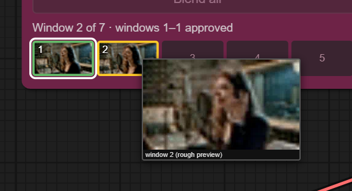

# Geiru Context Suite

ComfyUI nodes for long MiniMax H3 videos without the quality slowly falling apart: chains of clips, or one long render in overlapping windows.

> Formerly the **Clown Context Suite** (renamed to avoid mix-ups with ClownsharkBatwing's [RES4LYF](https://github.com/ClownsharkBatwing/RES4LYF) nodes). Old workflows still load.

## Credits

This suite builds on other people's work. All credit to them:

- **seitanism**: [ComfyUI-H3-Motion-Context-MultiRef](https://github.com/seitanism/ComfyUI-H3-Motion-Context-MultiRef). Holding the previous shot's real latents, masked, at the start of the next one is his method; Geiru Context is built on it.
- **NikoDemon80**: [ComfyUI-H3-Motion-Context](https://github.com/NikoDemon80/ComfyUI-H3-Motion-Context), the Chain node (copied in as [Geiru Chain](#geiru-chain), GPL-3.0), months of drift measurements, and the idea behind Window Director.
- **ethanfel (Lumifel)**: the context noise idea behind Geiru Context Noise ([ComfyUI-MiniMaxH3-Context-Loop](https://github.com/ethanfel/ComfyUI-MiniMaxH3-Context-Loop)), and [ComfyUI-H3-Prompt-IDE](https://github.com/ethanfel/ComfyUI-H3-Prompt-IDE).
- **drozbay**: native H3 latent-mask support and the masked-extension method everything here relies on ([MaskVidExperiments](https://github.com/drozbay/MaskVidExperiments)).
- **kijai**: ComfyUI's MiniMax H3 support and the H3 context windows ([PR #17425](https://github.com/Comfy-Org/ComfyUI/pull/17425)) that Hybrid Windows is built on, and the memory fix idea from [PR #17993](https://github.com/Comfy-Org/ComfyUI/pull/17993).
- **JalenBrunson**: [ComfyUI-HybridWindows](https://github.com/Jalen-Brunson/ComfyUI-HybridWindows), which Geiru Hybrid Windows works like.
- **ckinpdx**: Carry Attention in [ComfyUI-MMH3Tools](https://github.com/ckinpdx/ComfyUI-MMH3Tools), which led to Geiru Keystone Attention.
- **TrentHunter82**: [TrentNodes](https://github.com/TrentHunter82/TrentNodes). Its degrade node showed how much a clean frame 0 matters (the idea behind Keystone).
- **justinthevoid**: Window Director's **Replace selected** ([PR #6](https://github.com/roycho87/geiru_context_suite/pull/6)).
- Everyone on the Banodoco Discord and r/StableDiffusion who tested, argued and shared results.

## The problem, and the fix

Each chained H3 clip starts from the tail of the last one, so a little detail and colour is lost every clip and the loss stacks up.

Clip 1's first frame is the only frame from before any drift. **Geiru Keystone** pulls every shot back toward it, so the loss can't stack up. Start with the [Easily Distracted Clown](#example-workflows) example.

## Nodes

Most important first. Everything is under the **Geiru Context Suite** category.

| Node | What it does |
|---|---|
| **Geiru Context** | Holds the previous shot's last frames (and audio) at the start of this shot. Has the `degradation_protection` switch. |
| **Geiru Keystone** | Puts clip 1's first frame (the keystone) into every shot. |
| **Geiru Keystone Attention** | Makes the keystone pull harder than the carried frames on the lighting blocks, holding clip 1's brightness. |
| **Geiru Context Noise** | ethanfel's context noise on the held frames, so H3 doesn't copy them too exactly. |
| **Geiru Hybrid Windows** | One long render (a minute or more) in overlapping windows, with the keystone in every window. |
| **Geiru Window Director** | Optional, after Hybrid Windows: build the render one window at a time. |
| **Geiru Late Lock** | Picks the step Keystone's latents come in, so the shot picks its own pose first. |
| **Geiru Anchoring** | Holds a source's frames (and audio) at the end of this shot. |
| **Geiru Shot Counter** | The shot number. Can follow the Motion Context Chain node's count. |
| **Geiru Chain** | nikodemon's Motion Context Chain node, renamed. |

## Degradation protection (one switch)

Keystone, Late Lock, Keystone Attention and Context Noise keep their own settings. **Geiru Context**'s `degradation_protection` switch turns them all on (default) or off together. Use it on for long stretches of one scene, off around cuts. When the scene changes, point Keystone's `source_clip` at the first clip that fully shows the new scene.

**Wiring:** Geiru Context → Geiru Context Noise → (Geiru Anchoring) → Geiru Keystone → (Geiru Late Lock) → sampler, with the model through each of them, then through Geiru Keystone Attention to the guider.

**Turbo LoRA:** all testing used `minimax_h3_ref2v_turbo_8step_v1.0_768p_comfyui_resized_avg_rank_64_bf16`. Other turbos can handle the held frames differently; if you see degradation, try that one.

### Results

50-clip chain (about 5 min 20 s, four scenes, same seed): by clip 20 the plain chain had fallen apart; with protection it stayed clean.


Brightness lost by clip 10 of a beach chain: 28% with no protection, 22% with keystone only, 8% with keystone + Keystone Attention. Over 30 clips it held about −9%, against −17% for keystone + capstone ([NerdNotes, tests 19 and 20](https://github.com/roycho87/NerdNotes)).

## Geiru Context

Copies the previous shot's real latents into the start of this shot and masks them so the sampler keeps them. Frame counts go 5, 22, 39, 56… (17n + 5); drop settings go in steps of 17.

- `head_frames`: the overlap with the previous shot.
- `drop_last`: frees the last held frames so the model remakes them.
- `hold_audio`: holds the previous shot's audio for the overlap. `audio_drop_last` trims it, `audio_feather_ticks` fades it at the join.
- `shot_number` (optional, from the Shot Counter): the first shot passes through.

**Recommended:** `head_frames` 39, `drop_last` 17.

**Clip length:** use multiples of 3: **141**, **192**, **243**, **294** or **345** frames. Other lengths put the held audio off H3's audio grid and the sound builds up down the chain.

**Joining:** with 39 / `drop_last` 17, the new shot's frames 0-21 are exact copies of the previous shot's 153-174. Either cut the last 39 frames off every clip except the last, or cut the last 17 off each clip and the first 22 off the next. [Seamless Video Combiner](https://github.com/roycho87/workflows/blob/main/workflows/seamless_video_combiner/clussy_origin_story.json) does it for you, sound included.

## Geiru Keystone

- **keystone** = clip 1's first frame, locked into each shot's latent 0. With Geiru Context in front, the real frame is put back after sampling.
- **capstone** = a frame from the end of clip 1, tacked onto the back of the shot for each model call and cut off again.

| Setting | Meaning |
|---|---|
| `placement` | `keystone front` (default, recommended), `keystone front + back`, `capstone front + back`, `keystone front + capstone back`. |
| `source_clip` | The clip they come from (1 by default). Change it when the scene changes. |
| `latent_folder` | Your chain's Save Latent folder (e.g. `h3_ref2va`). Empty = use the source clip input. |

## Geiru Keystone Attention

Every frame's attention is shared between the prompt, references, sound, new frames, carried frames and keystone. Keystone Attention only re-splits the share between the **keystone** and the **carried frames**, on the 13 lighting blocks (31-33, 36-44, 47) that carry brightness. Works with any attention (Sage, PyTorch, Comfy Kitchen, ...).

Put it on the model line right before the guider and plug Keystone's `av_latent` into `latent`. It follows `degradation_protection`.

| Setting | Meaning |
|---|---|
| `balance` | How much harder the keystone pulls. 20 (default); 1 = off. |
| `take_from` | **context slice** (default, recommended): only the carried frames give up attention, about 5-10% slower. **whole pie**: everything gives up a little, near-free, holds less well. |
| `block_mode` / `blocks` | `lighting blocks`, or `custom blocks` with your own list. |

## Geiru Context Noise

ethanfel's context noise on Geiru Context's held frames: most noise at the start of the held context, none at the join, so H3 reads the context instead of copying it. Strength 1, fade linear.

## Geiru Hybrid Windows

Built on **kijai**'s H3 context windows and works like **JalenBrunson**'s [ComfyUI-HybridWindows](https://github.com/Jalen-Brunson/ComfyUI-HybridWindows) (after the [Rolling Diffusion](https://arxiv.org/abs/2402.09470) paper). I added the keystone, capstone and keystone attention.

1. Window 1 renders the first `switch_step` steps, then carries on to the end once to get its finished first frame (keystone) and last latent (capstone), and goes back.
2. Each later window renders its first `switch_step` steps in order, locked to the window before at the overlap, with the keystone.
3. The last steps run blended over the whole video, smoothing the joins.

GPU memory stays about the size of one window however long the video is: the full-length copies wait in system RAM, each window's own steps run on just that window, and they're freed before the blended steps.

Meant for fast-motion scenes that need to be seamless. Use at least two blend steps with `finished_handoff` on (e.g. `switch_step` 6 of 8). For one prompt per window, join one prompt node per window with **Conditioning Combine** into the guider and turn on `split_conds_to_windows`.

| Setting | Meaning |
|---|---|
| `context_length` / `context_overlap` | Window size and overlap in frames (17n + 5). |
| `switch_step` | Steps each window renders on its own before the blended finish. |
| `fuse_method` | How the blended steps average the windows (pyramid). |
| `freenoise` | Reuses window 1's noise for every window: more consistent, motion can repeat. |
| `split_conds_to_windows` | One prompt per window. |
| `crash_protection` | Saves after every window; press Run again after a crash to pick up there. |
| `detail_latent` | Optional input: use this latent's first frame as the keystone. |
| **Advanced** | |
| `keystone_swap` / `keystone_step` | The keystone locked into every later window, from `keystone_step`. |
| `keystone_attention` | Keystone Attention during each window's own steps, with the node's settings. |
| `back_capstone` / `capstone_step` | The capstone on the back of every later window, from `capstone_step`. |
| `context_noise` / `_strength` / `_fade` | Context noise on each window's locked overlap. |
| `sound_first` | Renders the sound first, then locks it in and renders the picture. |
| `finished_handoff` | Each window renders to the last step, and the next window locks to those finished frames. |

🎈 marks settings that must stay the same for a whole Window Director take.

**Top:** normal hybrid windows. **Bottom:** Geiru Hybrid Windows. Same seed and prompts.

https://github.com/user-attachments/assets/840d5913-4df5-488a-ae09-3f3056f7e9b7

## Geiru Window Director

Optional, after Hybrid Windows: build the render one window at a time instead of redoing the whole video when one window comes out wrong.

```
model → Geiru Hybrid Windows → Geiru Window Director → guider / sampler → VAE decode → video
```

| Button | What it does |
|---|---|
| **Approve** | Keeps this window and makes the next one. |
| **Run/Re-roll** | Makes the current window again. |
| **Rewind to selected** | Goes back to the window you clicked and makes it again. Later windows are dropped. |
| **Replace selected** | Once every window is made: makes only the window you clicked again, between its neighbours. Its start and the frames it hands to the next window are kept, so write the new middle to arrive there. Not window 1. |
| **Direct** | Approves on a loop until every window is made. |
| **Blend all** | Runs the blended last steps over the whole video (**Join all** with `bypass_blend` on). |
| **Reset** | Clears this run's saved windows. |

The strip shows one square per window (green = approved, yellow = ready, blue = rendering). Hover over a square to play a rough preview of that window.



| Setting | Meaning |
|---|---|
| `run_name` | Each name keeps its own windows in `output/geiru_window_director/<run_name>/`. |
| `new_seed_on_reroll` | Off: same noise, so a window only changes if its prompt or the seed changes. On: fresh noise. |
| 🎈 `keep_late_steps` | Saves each window's later steps, so you can raise `switch_step` and Blend all from there without remaking windows. |
| `bypass_blend` | Join the windows as approved, no blend. Use with `finished_handoff` on. |
| `preview` | **this window** or **all windows so far**, for the live preview. |

You can change a window's prompt and the protection settings between windows. Changing a 🎈 setting stops the run: set it back or press Reset.

## Geiru Late Lock

Goes between Keystone and the sampler. For the first `swap_step` steps the slot is empty so the shot picks its own pose, then Keystone's latent comes in. `slots`: capstone (default), keystone, or both. Default `swap_step` 4.

## Geiru Anchoring

Like Geiru Context, but holds a source's frames at the end of the shot. **Recommended:** `tail_frames` 56, `drop_first` 17 (must hold more frames than Context). Keystone and Late Lock skip the capstone when Anchoring is used.

## Geiru Shot Counter

| Setting | Meaning |
|---|---|
| `use_classic_counter` on | The `shot_number` box is the shot (`increment`, `decrement`, `fixed`, or `follow motion context`). |
| `use_classic_counter` off | The shot is the highest saved latent in `latent_prefix` + 1. |

## Geiru Chain

A renamed copy of nikodemon's Chain node, so you can use it with Motion Context or seitanism's MultiRef (which share node names and has no Chain node). Keep Load Latent, Save Latent and Geiru Chain in the same group.

| Button | What it does |
|---|---|
| **Approve** | Moves Load and Save up one and runs the next shot. |
| **Run/Re-roll** | Runs the current shot again. |
| **Chain** | Approve on a loop (`segments` 0 = until Stop). |
| **Reset** | Sets Load 0 / Save 1. |
| **Clear latents** | Deletes the saved shots in the Load folder. |

## Example workflows

Copies with plain names are in [Workflows with Boring Names](example_workflows/workflows_with_boring_names).

| Workflow | Boring name | What it is |
|---|---|---|
| **Easily Distracted Clown** | `long_chain_keystone_attention_and_context_noise` | **Current default for continuations.** Context Noise + Keystone + Keystone Attention. |
| **Clown Biker Babe** | `hybrid_windows_window_director_8_windows` | **Current default for Hybrid Windows.** Window Director, 60 s in 8 windows. |
| Mad Clown Inventor | `long_chain_keystone_and_late_lock` | Keystone + capstone + Late Lock. |
| Noisy Clown | `long_chain_plus_context_noise` | Mad Clown Inventor + Context Noise. |
| Clown Coaster | `hybrid_windows_60_second_simple` | 60 s Hybrid Windows, 8 windows. |
| Clowns for Picard | `hybrid_windows_60_second_widescreen` | Clown Coaster in widescreen with `sound_first`. |
| Clown Control Freak | `hybrid_windows_window_director_3_windows` | Window Director, 3 windows. |
| everyone_wants_a_piece_of_the_clown | `motion_context_chain_cntxt_and_anchors` | Context + Anchoring chain. |
| withers_has_big_nattys | `static_vlog_odd_even_shots_cntxt_and_anchors` | Static vlog: odd shots fresh, even shots continue. |
| sane_clown_combiner | `join_clips_into_one_video` | Joins 10 chain clips into one video. |

**Chain examples:** load your pictures, write the prompt in **H3 Prompt IDE**, and press **Chain** (or **Run/Re-roll**) on Geiru Chain, not ComfyUI's Run. **Window Director examples:** start with **Run/Re-roll**; the READ ME note walks through it.

**Other packs the examples use:** [ComfyUI-H3-Motion-Context](https://github.com/NikoDemon80/ComfyUI-H3-Motion-Context) or [MultiRef](https://github.com/seitanism/ComfyUI-H3-Motion-Context-MultiRef) (one, not both), [ComfyUI-H3-Prompt-IDE](https://github.com/ethanfel/ComfyUI-H3-Prompt-IDE), [ComfyUI-KJNodes](https://github.com/kijai/ComfyUI-KJNodes), [ComfyUI-VideoHelperSuite](https://github.com/Kosinkadink/ComfyUI-VideoHelperSuite), [rgthree-comfy](https://github.com/rgthree/rgthree-comfy), [ComfyUI-Custom-Scripts](https://github.com/pythongosssss/ComfyUI-Custom-Scripts), [ComfyUI-Easy-Use](https://github.com/yolain/ComfyUI-Easy-Use), [ComfyMath](https://github.com/evanspearman/ComfyMath).

## Moved to experimental repos

- **Geiru Protection LoRA**: [Geiru-Protection-LoRa-Experimental](https://github.com/roycho87/Geiru-Protection-LoRa-Experimental).
- **Geiru Prophecy** and its workflows: [Geiru-Prophecy-Experimental-](https://github.com/roycho87/Geiru-Prophecy-Experimental-).

## Install

Install **Geiru Context Suite** from ComfyUI-Manager, or:

```
cd ComfyUI/custom_nodes
git clone https://github.com/roycho87/geiru_context_suite
```

No extra Python packages needed.
